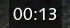
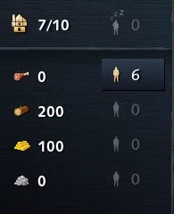

# Calibrage de l'interface AoE4 (1920x1080, échelle d'interface par défaut)

Relevé sur une capture en partie (Anglais, 00:13, 7/10 de pop). Boîtes en pixels
`(x1, y1, x2, y2)` ; à convertir en fractions de l'écran pour les autres résolutions,
à confirmer sur d'autres captures.

| Zone                      | Boîte (px)            | Exemple lu | Remarque |
|---------------------------|-----------------------|------------|----------|
| Horloge de partie         | (925, 100, 995, 128)  | `00:13`    | Centrée en haut, sous l'indicateur d'âge. Texte blanc sur fond sombre semi-transparent. |
| Population                | (38, 855, 90, 882)    | `7/10`     | Pop actuelle / max. Inclut les unités non-villageoises (éclaireur). |
| Villageois inactifs       | (140, 855, 165, 882)  | `0`        | Grisé quand 0. |
| Stock nourriture          | (38, 912, 110, 940)   | `0`        | |
| Stock bois                | (38, 951, 110, 979)   | `200`      | |
| Stock or                  | (38, 990, 110, 1018)  | `100`      | |
| Stock pierre              | (38, 1029, 110, 1057) | `0`        | |
| Vils sur nourriture       | (140, 912, 175, 940)  | `6`        | Case mise en surbrillance quand > 0. |
| Vils sur bois             | (140, 951, 175, 979)  | `0`        | Grisé quand 0. |
| Vils sur or               | (140, 990, 175, 1018) | `0`        | |
| Vils sur pierre           | (140, 1029, 175, 1057)| `0`        | |

## Observations

- Chiffres blancs, police fixe, bon contraste : une comparaison avec des chiffres de
  référence suffit. Les valeurs à 0 sont grisées, il faut un seuil plus bas ou un
  second jeu de chiffres de référence.
- Chiffres déjà vus sur cette capture : 0, 1, 2, 3, 6, 7. Il manque 4, 5, 8, 9 :
  il faudra d'autres captures, ou l'OCR de Windows en secours.
- Nombre total de villageois = somme des 4 compteurs par ressource + inactifs
  (+ les vils qui construisent ou se déplacent, non comptés ici : à vérifier).
- Liste des joueurs à droite (nom | âge | drapeau de civ) : le drapeau permettrait
  de reconnaître les civs à l'écran sans AoE4World, en secours.

## Captures de référence

